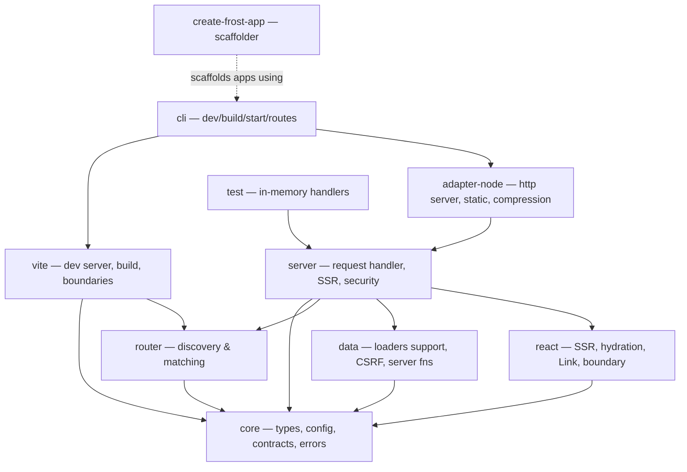
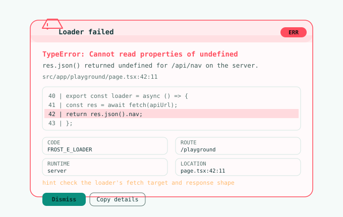

<div align="center">

<picture>
  <source media="(prefers-color-scheme: dark)" srcset="docs/assets/banner-dark.svg">
  
</picture>

<br>

Frost is a React full-stack framework built around explicit execution: server loaders, client hydration, route contracts, and runtime boundaries stay visible, testable, and predictable.

<p>
  <a href="https://www.npmjs.com/package/create-frost-app"></a>
  <a href="https://www.npmjs.com/package/@frost.js/core"></a>
  <a href="https://github.com/ben-bader/Frost/actions"></a>
  
  = 20" src="https://img.shields.io/badge/node-%3E%3D20-10e8c8?labelColor=0a1c1e">
  
</p>

<p>
  <a href="#quick-start">Quick start</a> ·
  <a href="#features">Features</a> ·
  <a href="#how-it-works">How it works</a> ·
  <a href="#compare">Compare</a> ·
  <a href="docs/README.md">Docs</a>
</p>

</div>

## The pitch

Most full-stack React frameworks hide the boundary between server and client behind conventions you have to memorize. Frost keeps it in the code. A route is a module with named exports — `loader`, `action`, `metadata`, `contract` — and each one runs in exactly one place. There is no implicit cache, no magic serialization, and no "it depends" when you ask where a piece of code executes.

That buys you three things in practice:

- **Predictable rendering.** Every page is server-rendered and streamed; hydration reconnects to serialized route data instead of re-running server logic.
- **Contracts you can test.** Params, search params, loader returns, and action input validate against Standard Schema validators (zod, valibot, arktype, or your own).
- **Errors you can read.** Server failures produce a styled browser overlay and a structured terminal block with a stable `FROST_E_*` code — not a wall of stack frames.

## Quick start

Requires Node.js >= 20.

```bash
npm create frost-app@latest my-app
cd my-app
npm install
npm run dev
```

Then open `http://localhost:3000`. You get the full starter: a landing page, a `/playground` route with client state, a contract-validated `/hello/[name]` route, app middleware, error and not-found pages, and Tailwind CSS already wired.

<picture>
  <source media="(prefers-color-scheme: dark)" srcset="docs/assets/terminal-dark.svg">
  
</picture>

<details>
<summary>pnpm, yarn, or bun</summary>

```bash
pnpm create frost-app my-app   # or: yarn create frost-app / bun create frost-app
cd my-app
pnpm install && pnpm dev       # yarn/bun equivalents
```

</details>

## Status

> [!NOTE]
> Frost is at **0.1.1**. The API may change before 1.0. Treat it as early but usable: routing, loaders, actions, contracts, middleware, streaming SSR, the dev server, and the Node adapter are covered by the test suite and exercised by the starter. The opt-in client router is experimental; static generation (SSG/ISR) is planned, not implemented.

## Features

<table>
<tr>
<td width="50%" valign="top">

**File-based routing**
`page.tsx` and `layout.tsx` files map to URLs, with `[param]` and `[...catchAll]` segments.

</td>
<td width="50%" valign="top">

**Loaders & actions**
Server data loading with parallel layout/page loaders, POST actions, and progressive-enhancement forms.

</td>
</tr>
<tr>
<td valign="top">

**Route contracts**
Validate params, search, loader returns, and action input with any Standard Schema validator.

</td>
<td valign="top">

**Typed end to end**
`defineRoute()` infers loader/params types; generated types give typed `Link` hrefs.

</td>
</tr>
<tr>
<td valign="top">

**Visible boundaries**
Client code reading non-public `process.env` fails the build; server-only imports are enforced transitively.

</td>
<td valign="top">

**Streaming SSR**
`renderToReadableStream` flushes the shell early; Suspense boundaries stream in.

</td>
</tr>
<tr>
<td valign="top">

**Honest dev errors**
Browser overlay plus a terminal `ERROR`/`WARN` block with code, file:line:column, and a code frame.

</td>
<td valign="top">

**Fast Refresh dev**
CSS hot-updates without reload, component state survives edits, loaders trigger reload, config restarts the server.

</td>
</tr>
<tr>
<td valign="top">

**Server functions**
`createServerFn` exposes typed RPC over `POST /_frost/fn` with CSRF and origin checks.

</td>
<td valign="top">

**Middleware**
`app/_middleware.ts` runs before routing for pages and API routes, with a memoized `next()`.

</td>
</tr>
<tr>
<td valign="top">

**Built-in hardening**
CSP nonces, Permissions-Policy, br/gzip compression, body limits, static-file containment.

</td>
<td valign="top">

**Client router** *(experimental)*
Opt-in fetch navigation with prefetch, scroll restoration, and full-reload fallback.

</td>
</tr>
<tr>
<td valign="top">

**Test utilities**
`@frost.js/test` builds request handlers from in-memory route modules — no browser needed.

</td>
<td valign="top">

**Small core**
Nine focused packages; import only what you need. Node adapter plus a fetch adapter for edge runtimes.

</td>
</tr>
</table>

## A route, in full

```tsx
// src/app/hello/[name]/page.tsx — from the starter
import type { Route, StandardSchemaV1 } from "@frost.js/core";

const nameSchema: StandardSchemaV1<string> = {
  "~standard": {
    version: 1,
    vendor: "starter",
    validate: (v) =>
      typeof v?.name === "string" && /^[a-zA-Z][\w-]{0,31}$/.test(v.name)
        ? { value: v.name }
        : { issues: [{ message: "invalid name" }] },
  },
};

export const contract = { params: nameSchema };

export const loader = async ({ params }: Route.LoaderArgs<{ name: string }>) => ({
  greeting: "Hello",
  name: params.name,
});

export default function HelloPage({ data }: Route.ComponentProps<HelloData>) {
  return <h1>{data.greeting}, {data.name}!</h1>;
}
```

One file declares the URL shape, the validation contract, the server loader, and the component. Layouts, metadata, headers, and middleware follow the same pattern — see [routing](docs/guides/routing.md), [contracts](docs/guides/contracts-and-types.md), and the [full code tour](docs/getting-started.md#what-the-scaffold-contains) in the docs.

<details>
<summary>Layout and API route</summary>

```tsx
// src/app/layout.tsx — loader data reaches every page below it
export const loader = async () => ({ nav: NAV_ITEMS });

export default function RootLayout({ children, data }: Route.ComponentProps<LayoutData>) {
  return <Shell nav={data.nav}>{children}</Shell>;
}
```

```ts
// src/api/hello/route.ts — REST endpoints live outside src/app
export function GET() {
  return Response.json({ hello: "world" });
}
```

API modules export `GET`/`POST`/`PUT`/`DELETE`/`PATCH`/`HEAD`/`OPTIONS` handlers receiving `(request, context)`. See [api routes](docs/guides/api-routes.md).

</details>

## How it works

<picture>
  <source media="(prefers-color-scheme: dark)" srcset="docs/assets/lifecycle-dark.svg">
  
</picture>

Every request flows through the same visible pipeline: app middleware, route matching, parallel loaders (page + layouts), streaming render, serialized HTML, then client hydration. Nothing runs twice and nothing is hidden.



| Package | Purpose | Import directly when |
|---|---|---|
| `@frost.js/core` | Config, types, contracts, errors, env | Defining `frost.config.ts` or route module types |
| `@frost.js/router` | Route discovery and matching | Custom tooling or tests |
| `@frost.js/data` | `dedupe`, CSRF, body parsing, `createServerFn` | Server functions outside routes |
| `@frost.js/react` | SSR document, hydration, `Link`, error boundary | Custom client entry or tests |
| `@frost.js/server` | Request handler, SSR, security headers, fetch adapter | Non-Vite hosts or tests |
| `@frost.js/adapter-node` | `node:http` server, static files, compression | Custom Node servers |
| `@frost.js/vite` | Vite plugin, dev protocol, build pipeline | — (used via `frost.config.ts`) |
| `@frost.js/cli` | `frost` binary | — |
| `@frost.js/test` | In-memory route handlers for tests | Writing route tests |
| `create-frost-app` | Scaffolder (`npm create frost-app`) | — |

The runtime boundary is a build-time guarantee: modules that touch server-only APIs are kept out of client bundles, and client code that reads non-`FROST_PUBLIC_*` environment variables fails the build.

## Developer experience

<picture>
  <source media="(prefers-color-scheme: dark)" srcset="docs/assets/overlay-dark.svg">
  
</picture>

On file save, the dev server classifies the change and does the minimum necessary work:

- **CSS** — hot-updates the stylesheet, no reload.
- **Component** — Fast Refresh preserves React state.
- **Loader, action, or API module** — full reload (data changed).
- **Route added/removed** — route table rebuilt, then reload.
- **`frost.config.ts`** — dev server restarts in-process and reloads when it's back on the same port.

Server errors surface in the browser overlay and the terminal at the same time, sharing one structured `FrostErrorReport` with a stable `FROST_E_*` code. See [dev server](docs/guides/dev-server.md) and [error handling](docs/guides/error-handling.md).

## Performance

Measured on this machine (Windows, Node v24.15.0, production `frost start`, starter app, `node audit-output/bench.mjs`, 2026-11-09). These are single-machine localhost numbers — useful for spotting regressions, not a comparison benchmark.

| Route | Sequential p50 | Sequential p95 | Concurrent p50 (10-wide) |
|---|---|---|---|
| `/` | 28.5 ms | 37.5 ms | 285 ms |
| `/playground` | 21.8 ms | 38.4 ms | 178 ms |

Concurrency on Windows localhost includes connection-setup noise; treat concurrent figures as an upper bound. Method and variance notes: [docs/performance.md](docs/guides/performance.md).

## Compare

Verified against official documentation on 2026-11-09; full sources in [docs/project/comparison.md](docs/project/comparison.md).

| | Frost | Next.js (App Router) | React Router (framework mode) | TanStack Start |
|---|---|---|---|---|
| Rendering | SSR + streaming, opt-out per deployment | SSR/SSG/ISR, React Server Components | SSR + optional SPA mode | SSR + selective SSR |
| Data loading | Explicit `loader`/`action` exports, parallel | `fetch` in Server Components, `use cache` | `loader`/`action`, client loaders | Router loaders + server functions |
| Route typing | Generated `routes.d.ts`, typed `Link`, `defineRoute` | `typedRoutes` (stable) | Generated `+types` per route | TanStack Router typegen |
| Runtime contracts | Standard Schema validation of params/search/data | None built in | None built in | Search-param schemas (router) |
| Client/server boundary | Build-enforced (`FROST_E_BOUNDARY`, env allowlist) | `"use client"` directive | Server actions removed from bundle | Server functions serialized |
| Deployment | Node adapter + fetch adapter | Vercel-first, Node output | Any Node host | Many targets (Nitro, CF, etc.) |
| Maturity | 0.1.x, one maintainer | Large ecosystem, industry standard | Remix-derived, broad adoption | Newer, growing |

Choose Frost if you want the server/client boundary enforced at build time, explicit loader contracts, and readable dev errors — and you are comfortable with a young framework. Choose Next.js for the largest ecosystem and Vercel integration, React Router if you want Remix-style conventions with the biggest community, or TanStack Start for type-safe routing on many deploy targets.

## Roadmap

- **Next:** 1.0 stabilization, more host adapters (Vercel/Netlify-style).
- **Later:** static generation (SSG/ISR), evaluation of RSC semantics.
- **Exploring:** image optimization, i18n routing, partial prerendering, view transitions.

See [docs/project/roadmap.md](docs/project/roadmap.md) for detail and status.

## Documentation

| Start here | Reference |
|---|---|
| [Getting started](docs/getting-started.md) | [Configuration](docs/reference/configuration.md) |
| [Concepts](docs/concepts.md) | [CLI](docs/reference/cli.md) |
| [Architecture](docs/architecture.md) | [API reference](docs/api/core.md) |
| [Routing](docs/guides/routing.md) | [Error codes](docs/reference/error-codes.md) |
| [Data loading](docs/guides/data-loading.md) | [File conventions](docs/reference/file-conventions.md) |
| [Contracts & types](docs/guides/contracts-and-types.md) | [create-frost-app](docs/reference/create-frost-app.md) |
| [Middleware](docs/guides/middleware.md) | [Comparison](docs/project/comparison.md) |
| [Security](docs/guides/security.md) | [Troubleshooting](docs/project/troubleshooting.md) |
| [Deployment](docs/guides/deployment.md) | [Contributing](CONTRIBUTING.md) |

## Contributing

Issues and PRs welcome — see [CONTRIBUTING.md](CONTRIBUTING.md). Security reports: [SECURITY.md](SECURITY.md). Licensed [MIT](LICENSE).

<p align="center">
  
  <sub>MIT · <a href="docs/README.md">Documentation</a></sub>
</p>
