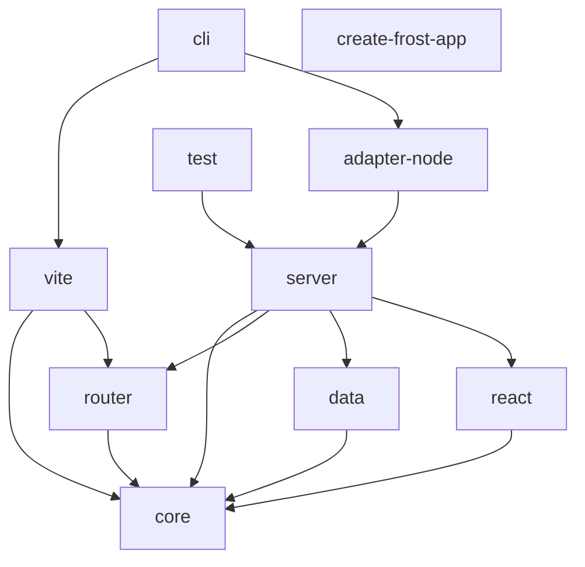

# Architecture

> How the Frost monorepo is organized: package boundaries, the request pipeline, the build, and the dev server.

**Last verified against v0.1.1.**

## Packages

Frost is a pnpm monorepo. Dependencies flow one direction — leaf packages first:

| Package | Role |
|---|---|
| `@frost.js/core` | Shared types (`Route.*`, `FrostRequestContext`), `FrostConfig`, error codes, contracts, env loading, logger, diagnostics |
| `@frost.js/router` | Filesystem route discovery, path normalization, matching |
| `@frost.js/data` | `dedupe` request memo, CSRF, body parsing with limits, `createServerFn` registry |
| `@frost.js/react` | `FrostDocument`, hydration entry, `Link`, `FrostErrorBoundary`, client context/hooks |
| `@frost.js/server` | `createRequestHandler` — the whole request lifecycle; SSR render; security headers; fetch adapter; server-fn transport |
| `@frost.js/adapter-node` | `node:http` bridge, static file serving with containment, MIME, br/gzip compression, ETags |
| `@frost.js/vite` | Vite plugin: config loading/restart, route manifest, CSS graph, client boundary guard, dev protocol, production build |
| `@frost.js/cli` | `frost` binary: `dev`, `build`, `start`, `routes` |
| `@frost.js/test` | `createTestHandler`, `renderRoute`, `callLoader`, `callAction` — in-memory route modules |
| `create-frost-app` | Bin-only scaffolder; `template/` generated from `examples/starter` at pack time |

## Request pipeline

`createRequestHandler` (in `@frost.js/server`) is the single entry point. In order:

1. **Middleware** — `app/_middleware.ts` modules run before routing. `next()` is memoized, so a middleware that calls `next()` and returns `undefined` does not re-run loaders.
2. **Method gate** — pages accept GET/HEAD (+POST for actions); APIs dispatch by exported verb.
3. **Route match** — `matchRoute` resolves pathname → route + params; percent-decoding is per-segment and malformed escapes return 400.
4. **Contract validation** — params/search schemas run (dev always; prod when `contracts.validateInProduction`).
5. **Loaders** — page loader and all layout loaders run in parallel via `Promise.all`; each layout receives its own loader result.
6. **Action** — POST to a page URL runs `action` after CSRF + body-limit checks, then re-renders with `actionData`.
7. **Metadata + render** — metadata resolves in parallel with loaders; the tree renders through `renderRouteToHtml` (streaming when `ssr.streaming`).
8. **Response** — `html()`/`json()`/`redirect()` helpers; route `headers` export applies; security headers + CSP nonce attach.
9. **Serialize** — loader data goes into `__FROST_DATA__` inside the document for hydration.

API routes under `apiDirectory` (default `src/api`) map to `/api/**` and receive `(request, context)`.

## Server functions

`createServerFn` registers a named handler in `@frost.js/data`'s registry. On the server it is callable directly; the Vite plugin rewrites client-side imports into fetch stubs that POST to `serverFns.path` (default `/_frost/fn`). The transport validates origin/CSRF, runs `validateInput`, and returns typed JSON errors (`FROST_E_SERVERFN`, `FROST_E_CONTRACT`) without stack traces.

## Build pipeline

`frost build` (via `@frost.js/vite`):

1. Loads and resolves `frost.config.ts`.
2. Discovers routes, builds per-route client bundles (code-split).
3. Emits `.frost/client/` assets + `assets.json` manifest, `.frost/server/` entries, sitemap/robots when enabled.
4. Optionally pre-compresses assets (br + gzip) and prints `--analyze` bundle report; `budgets.clientJsKb` + `--strict` can fail the build.

`frost start` serves `.frost/` through `@frost.js/adapter-node`: static files with realpath containment, dynamic requests through the handler, compression negotiation, per-encoding ETags.

## Dev pipeline

`frost dev` runs a Vite dev server with the Frost plugin:

- Route discovery and the CSS graph are cached and invalidated by watcher events (debounced ~50 ms).
- Every change is classified (`frost:*` protocol over `server.ws`): CSS → style update, component → Fast Refresh, loader/API/config → reload or restart.
- Server errors become `FrostErrorReport`s pushed to the browser overlay and printed as terminal `ERROR`/`WARN` blocks.
- `dev.checkDeterminism` renders each route twice and warns on nondeterministic output.

## Boundaries

Three enforcement points keep the model honest:

- **Build**: `SERVER_ONLY_RE` / client-boundary transform fails builds that leak server code or non-public env vars into client bundles.
- **Runtime**: contracts validate untrusted input; CSRF and body limits guard mutations.
- **Types**: `defineRoute()` + generated `routes.d.ts` make route shapes compile-time visible.

## Related

- [Concepts](concepts.md) · [Rendering](rendering.md) · [Request lifecycle diagram)(assets/) (see README)
- Decisions: `docs/decisions/` (config loading, CSP nonce, env allowlist, compression, dev protocol, …)
